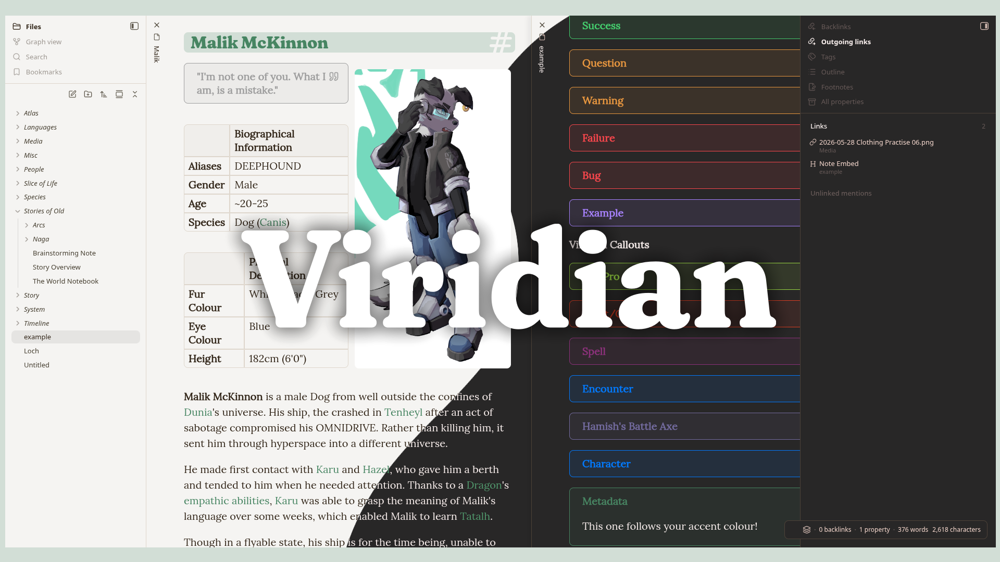
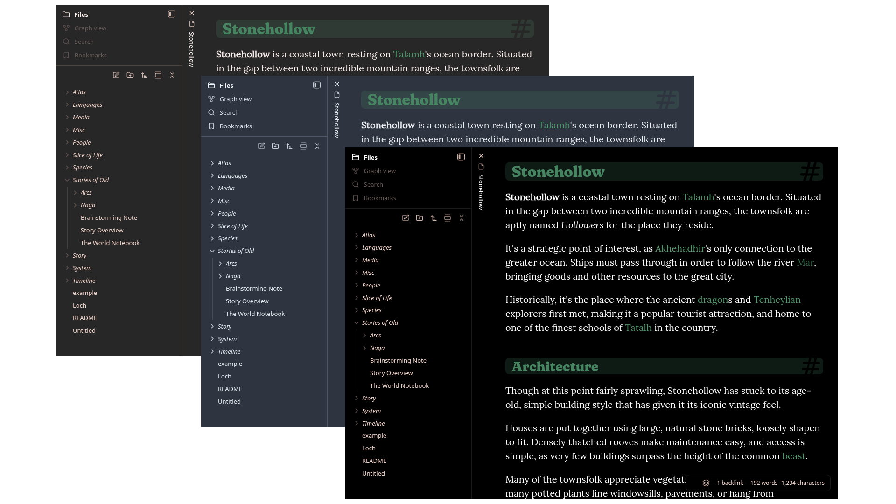
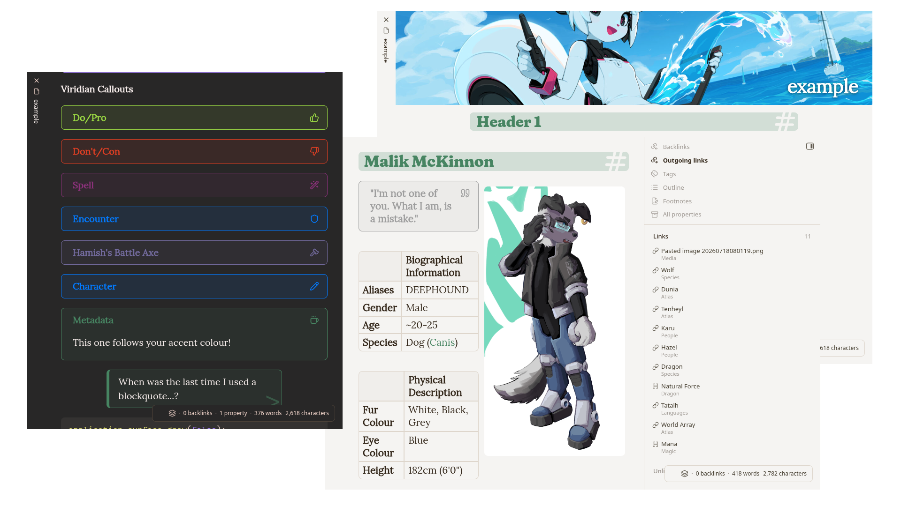
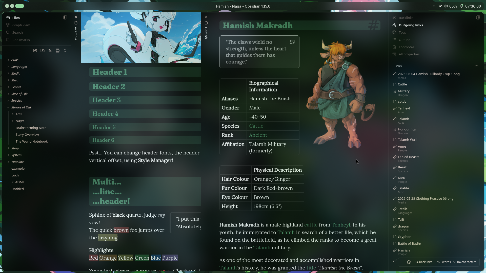

# Viridian

> A theme designed to make your time in Obsidian joyful, and focused.

Viridian is an [Obsidian](https://obsidian.md) theme for a curated desktop experience, with (primitive, but improving!) mobile support.

## Contents
- [Quickstart](#quickstart)
- [Screenshots](#screenshots)
- [Design Goals](#design-goals)
- [Plugins](#plugins)
- [Settings](#settings)
- [Colour Schemes](#colour-schemes)
- [Recommendations](#recommendations)
- [Transparency](#transparency)
- [It's back!](#its-back)
- [Acknowledgements](#acknowledgements)

## Quickstart
Viridian is meant to be a very non-intrusive theme by default. You can use it straight out of the box, and keep all your preferences from Obsidian (font family, accent colour, etc).

Everything in this section is optional, but I recommend having a quick peek through anyways.
1. Install helper plugins (Highly Recommended)
	1. Install [Style Manager](https://community.obsidian.md/plugins/style-manager), exposes Viridian's full settings
	2. Install [Hider](https://community.obsidian.md/plugins/obsidian-hider), allows you to elegantly hide certain Obsidian elements
2. Change your accent colour to Viridian's
	1. Settings > Appearance > Accent Colour > Restore Default
3. (Style Manager) Choose your font scheme
    1. None (Keeps your Obsidian preferences)
    2. Serif (Default, uses Fraunces, Lora, and Victor Mono)
    3. Sans (Uses Lexend, Manrope, and Inter)

Check out my [recommended configs](#mulfoks-configs)

## Screenshots

> There's an example.md in the repository if you would like to play around with Viridian!

**Colour schemes** let you enjoy Viridian in a variety of my favourite flavours.

Viridian's **extra features** let you write notes with some extra, obsidian-style flare, so that things don't look wrong in other themes.

When I use Viridian, I like a *transparent window.* (See [Transparency](#transparency).)

## Design Goals
Viridian's design goals have always been simple, in my head.

This is what I want from Viridian:
1. It needs to be **functional.** (no clutter!)
2. It needs to be **pleasant to look at.** (fun!)
3. It needs to be **nondestructive.** (keep things familiar!)

## mulfok's Configs
I enjoy using Obsidian in a particular way. Generally, I like to use lots of hotkeys, and forget about things I don't actively use.

Obviously not everyone is like this, which is why Viridian does not treat this as "default" behaviour.

Here are the things I like, why not try a few out?

- Interface > **Disable tab title bar**
- Interface > **Disable ribbon**
- Interface > Advanced > Window frame style > **Native** (Linux thing, I don't window decorations!)
- Editor > Display > Properties in document > **Hidden**
- Hider > Interface > **Hide tab bar** (when using stacked tabs)
- Hider > Interface > **Hide status bar** (sometimes)
- Hider > Interface > **Hide vault name**
- Hider > Interface > **Hide scroll bars**
- Style Manager > Viridian > **Left Navigation Labels**

## Transparency
As far as I know, Obsidian does not currently provide an easy way to have a transparent window, and it falls to the user to set it up on their system instead.

On Linux, I personally use my window manager's compositor effects to make Obsidian around 20% transparent, along with some background blur. For this, I recommend using the **OLED** theme (which I made specifically for this purpose) through **Style Manager.**

## It's back!
Viridian was originally conceived in 2022 (some of you may remember), when I was around sixteen. Life started approaching very fast, and I ended up burning out after Viridian broke upon Obsidian's transition to stable releases (1.x.x). It's been a little over **four years** of radio silence.

I apologise! Viridian is now much easier for me to maintain, so I hope to chip away at it for years to come.

Truthfully, I've been using Obsidian this entire time silently, my setup just became much more minimal and lightweight. The new and improved Obsidian-theming lent itself well to this new state of mind, so it ended up being "good enough" for me.

I can't say for sure what changed, or what spurred it on (probably nostalgia), but today (2026), I decided to overhaul Viridian, for the "modern" Obsidian.

## Acknowledgements
Big thanks to kepano behind [Minimal](https://community.obsidian.md/themes/minimal), and Alexis C behind [Baseline](https://community.obsidian.md/themes/baseline) for the inspiration behind the labelled navigation pane.

Thanks to ElsaTam (Kapirklaa on Discord) for the float.css that is included in Viridian.

And big thanks to previous and current users of Viridian! The kind comments are extremely appreciated <3
